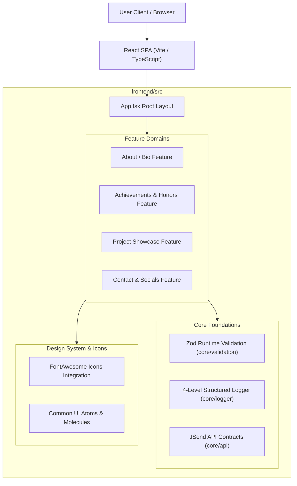

# System Architecture & Technical Specifications: NguyenKhangPortfolio

## 1. Architectural Overview
NguyenKhangPortfolio is a high-performance, responsive single-page portfolio application built with React 19, TypeScript, and Vite. The design philosophy adheres to Clean Architecture, Feature-Driven Modularization, and Zero Root Clutter standards.



---

## 2. Technical Stack Matrix
| Layer | Technology | Purpose |
| :--- | :--- | :--- |
| **Runtime & Framework** | React 19 / TypeScript | UI Component Rendering & Type Safety |
| **Build & Dev Tool** | Vite | Lightning-fast HMR and optimized bundler |
| **Package Manager** | npm (Fixed) | Single-lockfile package management |
| **Iconography** | FontAwesome SVG Core | SVG icon rendering with tree-shaking |
| **Runtime Validation** | Zod (v3.25+) | Schema validation for env and data models |
| **Logging** | Custom Structured Logger | 4-level logging (`DEBUG`, `INFO`, `WARN`, `ERROR`) |
| **Data Contract** | JSend Specification | Standardized data envelopes |

---

## 3. Directory Isolation Standards
- **`frontend/`**: Contains client-side React code, styles, tests, and build configurations.
- **`docs/`**: Official architectural blueprints, RFCs, and session progress trackers (`PROGRESS.md`).
- **`.local/`**: Centralized developer scratchpad (`.local/scratch/`, `.local/docs/`) completely ignored by Git.

---

## 4. JSend Standard Contract
All API data exchange conforms strictly to JSend:
```json
// Success
{
  "success": true,
  "data": { "portfolio": {} },
  "message": "Portfolio retrieved successfully"
}

// Failure
{
  "success": false,
  "error": {
    "code": "VALIDATION_FAILED",
    "message": "Invalid portfolio data schema",
    "details": [...]
  }
}
```
